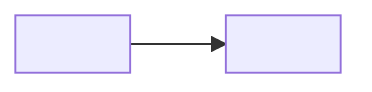

<!--
PLANTILLA DE README (misma estructura en todos mis repos)

Cómo usarla:
1. Copia este archivo al repo como README.md y borra estos comentarios de guía.
2. Sustituye cada <PLACEHOLDER>. Si una sección no aplica al repo, quítala entera.
3. Cero invención: cada cifra sale de un comando ejecutado (tests, PRs, versiones).
   Lo que no se pueda verificar se omite o queda como <!-- TODO: ... -->.
4. Emojis solo en los títulos de sección (única excepción: el corazón del pie final). Máximo 3 alertas de GitHub ([!NOTE], [!TIP], [!IMPORTANT], [!WARNING]).
5. Prohibido: widgets externos que se rompen (github-readme-stats, contadores de visitas) y frases de marketing.
6. Si cambias un título con emoji, actualiza su ancla en el índice (el emoji se ignora y deja un guion inicial: "## 🎯 ¿Por qué existe?" -> #-por-qué-existe).
-->

<!-- 1. CABECERA CENTRADA -->
<div align="center">

" width="88" alt="Logo de <NOMBRE>">

# <NOMBRE>

**<Frase de valor, máximo 15 palabras.>**

<!-- Badges shields.io, estilo flat. Estado, licencia, CI (si existe), tests (cifra real) y 4-5 tecnologías con logo. -->
[](<URL>)
[](LICENSE)
[](https://github.com/mkcodev/<REPO>/actions)
[](#-calidad)
[](<URL>)

[Demo](<URL-DEMO>) · [Documentación](docs/) · [Reportar un bug](https://github.com/mkcodev/<REPO>/issues/new)

</div>

<!-- 2. CAPTURA O GIF PRINCIPAL (en docs/assets/), con versiones para tema claro y oscuro si las hay -->
<picture>
  <source media="(prefers-color-scheme: dark)" srcset="docs/assets/<hero-dark.png>">
  " alt="<Descripción de lo que muestra>" width="100%">
</picture>

<!-- 3. RESUMEN EN INGLÉS: 3-4 líneas -->
<details>
<summary>🇬🇧 English summary</summary>

<What it is, who it is for, the key idea and the stack, in 3-4 lines.>

</details>

<!-- 4. TABLA DE CONTENIDOS -->
## Contenido

- [¿Por qué existe?](#-por-qué-existe)
- [Funcionalidades](#-funcionalidades)
- [Stack](#-stack)
- [Arquitectura](#-arquitectura)
- [Decisiones técnicas](#-decisiones-técnicas)
- [Calidad](#-calidad)
- [Desarrollo con IA](#-desarrollo-con-ia)
- [Empezar](#-empezar)
- [Roadmap](#-roadmap)
- [Autor](#-autor)
- [Licencia](#-licencia)

<!-- 5. POR QUÉ EXISTE: el problema real en 2-3 frases y para quién es -->
## 🎯 ¿Por qué existe?

<Problema real en 2-3 frases. Para quién es.>

<!-- 6. FUNCIONALIDADES: tabla de 2 columnas (+ estado). Lo pendiente puede ir con casillas en el Roadmap -->
## ✨ Funcionalidades

| Funcionalidad | Qué aporta |
|---|---|
| <Funcionalidad> | <Qué aporta al usuario> |

<!-- Aviso clave opcional: > [!NOTE] ... -->

<!-- 7. STACK: tabla agrupada, con el motivo de cada elección en una línea -->
## 🧰 Stack

| Capa | Tecnología | Por qué |
|---|---|---|
| Frontend | <Tecnología> | <Motivo en una línea> |
| Backend | <Tecnología> | <Motivo> |
| Datos | <Tecnología> | <Motivo> |
| Testing y CI | <Tecnología> | <Motivo> |
| Herramientas | <Tecnología> | <Motivo> |

<!-- 8. ARQUITECTURA: Mermaid generado desde el código real + árbol de carpetas (una línea por carpeta) -->
## 🧱 Arquitectura



```text
.
├── <carpeta>/   <Qué contiene>
└── <carpeta>/   <Qué contiene>
```

<!-- 9. DECISIONES TÉCNICAS: 3 a 5 mini-ADR plegables (Contexto -> Decisión -> Consecuencia) -->
## 🧭 Decisiones técnicas

<details>
<summary><strong>1. <Título de la decisión></strong></summary>

- **Contexto:** <Situación y restricción.>
- **Decisión:** <Qué se eligió.>
- **Consecuencia:** <Qué se gana y qué se paga.>

</details>

<!-- 10. CALIDAD: cómo se testea, cifra real de tests, qué valida la CI, Lighthouse solo si hay datos verificados -->
## ✅ Calidad

- **Tests:** <N> pasan, en <M> archivos.[^1]
- **CI:** <Qué ejecuta y cuándo.>
- **Lighthouse:** <Solo con datos medidos.>

[^1]: Resultado de `<comando>` sobre `main` el <AAAA-MM-DD>.

<!-- 11. DESARROLLO CON IA: solo hechos verificables en el historial (trailers de commit, flujo, revisión, tests) -->
## 🤖 Desarrollo con IA

- **Trazabilidad:** <Cifra obtenida con git log.>
- **Revisión:** <Cómo se revisa el código generado.>
- **Red de seguridad:** <Tests y CI.>

<!-- 12. EMPEZAR: requisitos, instalación, ejecución y variables de entorno (sin valores reales; usar .env.example) -->
## 🚀 Empezar

**Requisitos:** <Versiones.>

```bash
<comandos de instalación y ejecución>
```

| Variable | Para qué |
|---|---|
| `<VARIABLE>` | <Qué configura> |

<!-- 13. ROADMAP: próximos pasos con casillas -->
## 📍 Roadmap

- [x] <Hecho>
- [ ] <Pendiente>

<!-- 14. AUTOR (igual en todos los repos) -->
## 👤 Autor

**Mikel Salvador** · AI-Augmented Full-Stack Developer

[LinkedIn](https://linkedin.com/in/mkcodev) · [Web](https://mkcodev.com) · [info@mkcodev.com](mailto:info@mkcodev.com)

<!-- 15. LICENCIA -->
## 📄 Licencia

<Licencia> (ver [LICENSE](LICENSE)).

<!-- 16. PIE FINAL (igual en todos los repos) -->
---

<br>

<div align="center"><sub>Made with ❤️ by <a href="https://mkcodev.com">mkcodev</a> · AI-Augmented Full-Stack Developer</sub></div>
